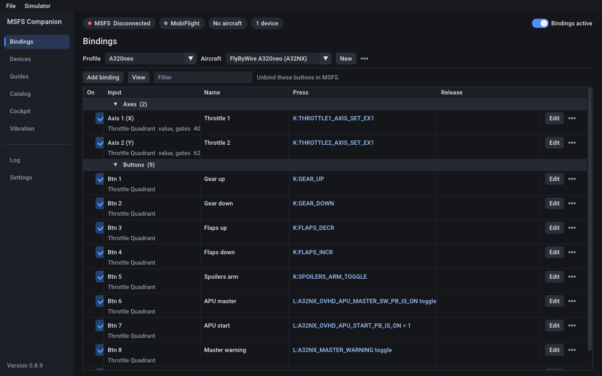
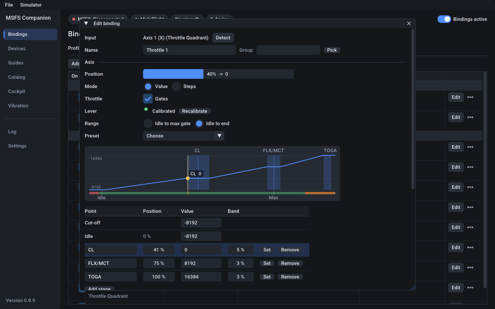
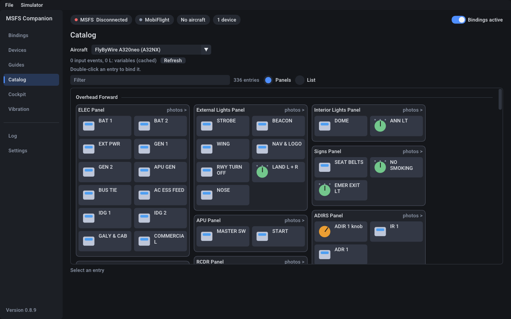
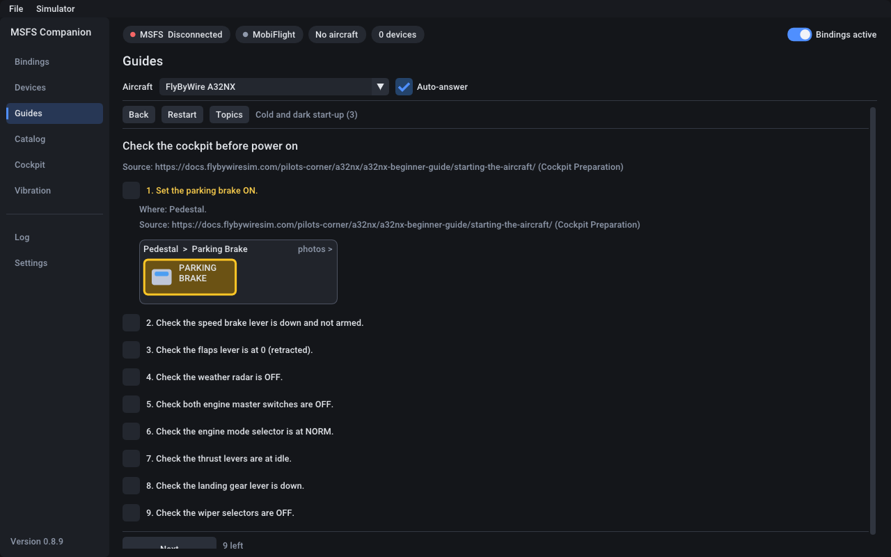
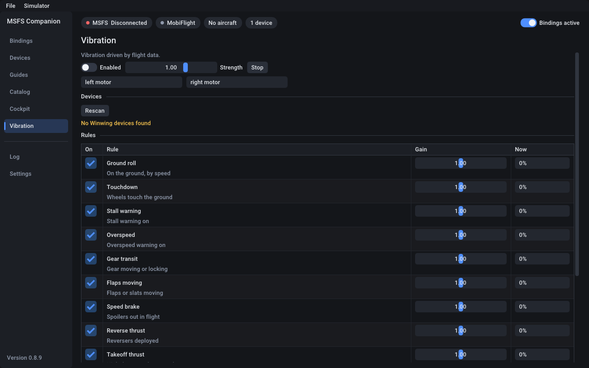

# msfs-linux-companion

Bind your HOTAS to Microsoft Flight Simulator 2020 and 2024 **from Linux**, including the cockpit controls the in-game
controls menu cannot bind (the A32NX FCU, EFIS, autobrake, ...). Native Linux, no Wine component: it talks SimConnect over
TCP to the sim running under Proton.



## Features

* **Home**: what you are flying, the profile, the sim and your devices at a glance; *Bind a control* by pressing it; what needs a
  look (bindings not tried, buttons your MSFS control profile also uses, a profile that does not fit the aircraft).
* **Bindings** per aircraft: buttons, hats and axes to sim events, cockpit controls, `L:` variables or RPN code, with press /
  release actions, repeat while held and two-position switches. Profiles can list several aircraft and switch by themselves.
* **Themes**: Slate, Night, Daylight, High contrast, and flight-deck themes (Airbus, Boeing 787, Boeing 777, Citation, Garmin G1000,
  Fighter HUD); a profile can bring its own.
* **Throttle calibration** for levers with gates: leave out the cut-off, use idle to the max gate or to the end, add named
  stages (Airbus CL, FLX/MCT, TOGA), start from a recipe, and let the cut-off zone run reverse thrust.
* **Cockpit catalogs** to pick controls from: A32NX, A380X, A320neo V2 and A400M (MSFS 2024), CJ4 (MSFS 2020 and 2024), F/A-18E, Spirit of St. Louis, Vision Jet, Cabri G2, and an
  automatic one for any other aircraft.
* **Guides**: step-by-step procedures in the app, with steps the sim confirms ticked for you.
* **Vibration** for Winwing URSA MINOR devices, driven by flight data.
* **Plugins** for new aircraft, tabs and commands.
* Wayland or X11, or `--headless`. Uses about 0.2 % of one core next to a running sim.

| | |
|---|---|
|  |  |
| **Throttle**: idle to end with CL, FLX/MCT and TOGA stages | **Catalog**: the A32NX cockpit by panel |
|  |  |
| **Guides**: a step of the A32NX start-up, with the control lit | **Vibration**: rules that drive the Winwing motors |

## Install

Download the AppImage from [Releases](https://github.com/Kyr4l/msfs-linux-companion/releases), then:

```sh
chmod +x msfs-linux-companion-*-x86_64.AppImage
./msfs-linux-companion-*-x86_64.AppImage
```

Or the Flatpak (`packaging/build-flatpak.sh` builds it):

```sh
flatpak install --user msfs-linux-companion-*-x86_64.flatpak
flatpak run io.github.Kyr4l.MsfsLinuxCompanion
```

The Flatpak keeps its settings in `~/.var/app/io.github.Kyr4l.MsfsLinuxCompanion/config/msfs-linux-companion`. To bring over
the AppImage's, with the program closed: `cp -a ~/.config/msfs-linux-companion ~/.var/app/io.github.Kyr4l.MsfsLinuxCompanion/config/`.

It reads Steam libraries under `~/.local/share/Steam`, `/mnt`, `/media` and `/run/media`; for one elsewhere:
`flatpak override --user --filesystem=/path/to/SteamLibrary:ro io.github.Kyr4l.MsfsLinuxCompanion`.

Or build it (GCC 12+, CMake 3.20+, GLFW 3.4+):

```sh
git clone --recursive https://github.com/Kyr4l/msfs-linux-companion.git
cd msfs-linux-companion
cmake -S . -B build -G Ninja -DCMAKE_BUILD_TYPE=Release
ninja -C build
./build/msfs-linux-companion
```

On the sim side there is usually nothing to do: the program finds the port SimConnect listens on under Proton. For `H:`
events and `L:` variables install the [MobiFlight WASM module](https://github.com/MobiFlight/MobiFlight-WASM-Module/releases)
in the `Community` folder. Details, command-line options and upgrading: [docs/INSTALL.md](docs/INSTALL.md).

## Quick start

1. Start MSFS and the program.
2. **Bindings**: *Add binding*, *Detect*, press the button, add actions by hand or *From catalog*, *Save*. *Test* fires them.
3. Leave the same buttons and axes unassigned in the MSFS controls menu, otherwise both fire.

## Documentation

| | |
|---|---|
| [Install and set up](docs/INSTALL.md) | build, AppImage, SimConnect port, MobiFlight, options, upgrading |
| [Using the program](docs/USAGE.md) | bindings, axes, profiles, the Cockpit tab, guides, tips |
| [Throttle calibration](docs/THROTTLE.md) | gates, ranges, stages, the Airbus and F/A-18E presets |
| [Vibration](docs/VIBRATION.md) | how the Winwing motors are driven, supported devices |
| [Troubleshooting](docs/TROUBLESHOOTING.md) | device permissions (udev), session logs when the sim crashes |
| [What was tested](docs/TESTED.md) | what was checked on real hardware and aircraft, and what was not |
| [Performance](docs/PERFORMANCE.md) | what the program costs next to the sim |
| [Plugins](docs/PLUGINS.md) · [Guide files](docs/GUIDES.md) | writing plugins and guides |
| [Development](docs/DEVELOPMENT.md) | mock simulator, catalog tools, tests |

## How it was made

Written with AI assistance (Claude), directed and reviewed by the maintainer. Every hardware path was run on the real devices
it targets. Many aircraft catalogs and guides have not been tried on the aircraft yet; [docs/TESTED.md](docs/TESTED.md) says
which.

## License

Copyright (C) 2026 Kyr4l. **GPL-3.0-only** (see [LICENSE](LICENSE)); third-party components and data sources are listed in
[THIRD_PARTY_NOTICES.md](THIRD_PARTY_NOTICES.md). Releases up to 0.5.0 were published under the MIT licence and stay MIT for
whoever received them.
